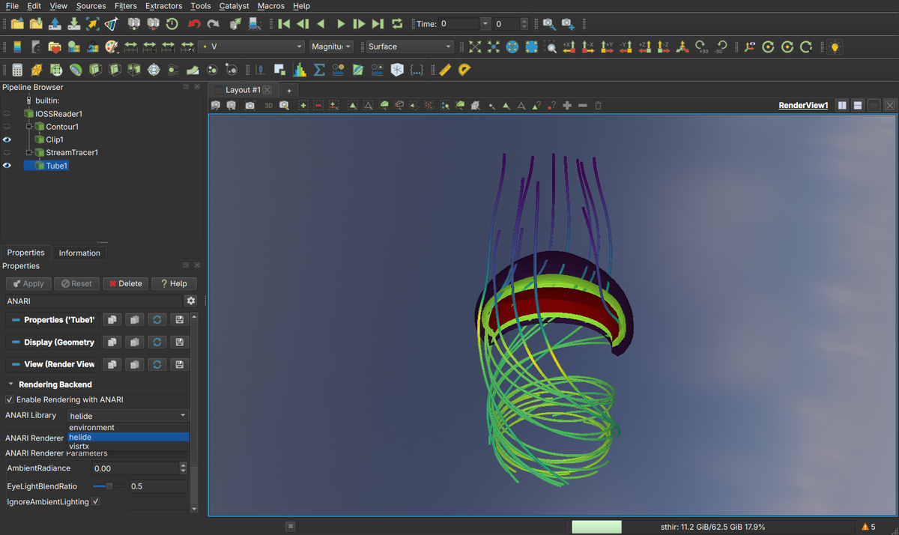
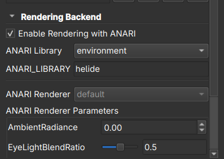

## Choose the ANARI library from the view properties

You can now pick which ANARI device library renders a **Render View**. With advanced properties shown, the **Rendering Backend** group gains an **ANARI Library** combo-box as soon as **Enable ANARI** is checked:

* `helide` - the reference CPU device that ships with the ANARI SDK,
* `environment` - the library named by the `ANARI_LIBRARY` environment variable.

Choosing `environment` also displays that variable's current value, or `(not set)`, as a read-only **ANARI_LIBRARY** field, so the panel always names the library actually in use. The combo-box starts on `environment` when `ANARI_LIBRARY` is set in your environment, and the library can be changed at any time while ANARI rendering is on.

*Choosing the device library while the view renders temperature isosurfaces and velocity streamlines through ANARI.*

*With `environment` selected, the panel reports the value the variable holds.*

The list of libraries is fixed; ANARI devices installed on your machine are not discovered automatically.

ANARI rendering itself also behaves better in several places:

* Scenes lit by directional lights - which is what the default headlight is - are no longer much darker than the same scene rendered with OpenGL.
* Recoloring a representation by a different array now updates the rendered image instead of keeping the previous colors.
* Backgrounds and skyboxes keep their brightness.
* Switching the library no longer crashes, and changing it while ANARI is off no longer discards whichever render pass the view was using.

### Developer notes

`vtkPVRenderView` no longer chooses an ANARI library on its own when ANARI is enabled. The `ANARILibrary` proxy property is the single source of truth and `vtkSMRenderViewProxy` pushes it down whenever ANARI is switched on, so anything driving the view through the proxy layer, including Python, sees the same library the Properties panel shows. `vtkPVRenderView::GetANARILibrary()` returns an empty string when no ANARI pass exists yet rather than dereferencing one.
