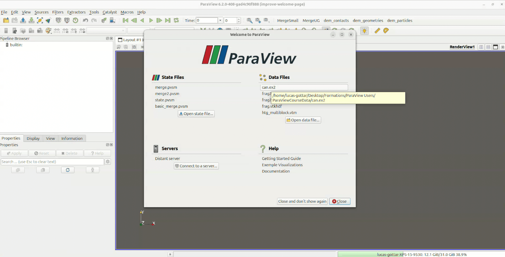

## Improve Welcome Page

The Welcome Page has been redesigned.
It is now possible to open recent state files or recent data files.
There are also buttons to open another data or another state file from the Welcome page.
It is also possible to connect to a recent server or to open the page of Server Configurations.
A link to ParaView documentation has been added.
The checkbox to never show the window again has been replaced by a button.

*New Welcome Page.*

### Developer notes

Since there are no logner checkbox to set the "Do not show again" state, the protected method `onDoNotShowAgainStateChanged(Qt::CheckState)` has been removed.
